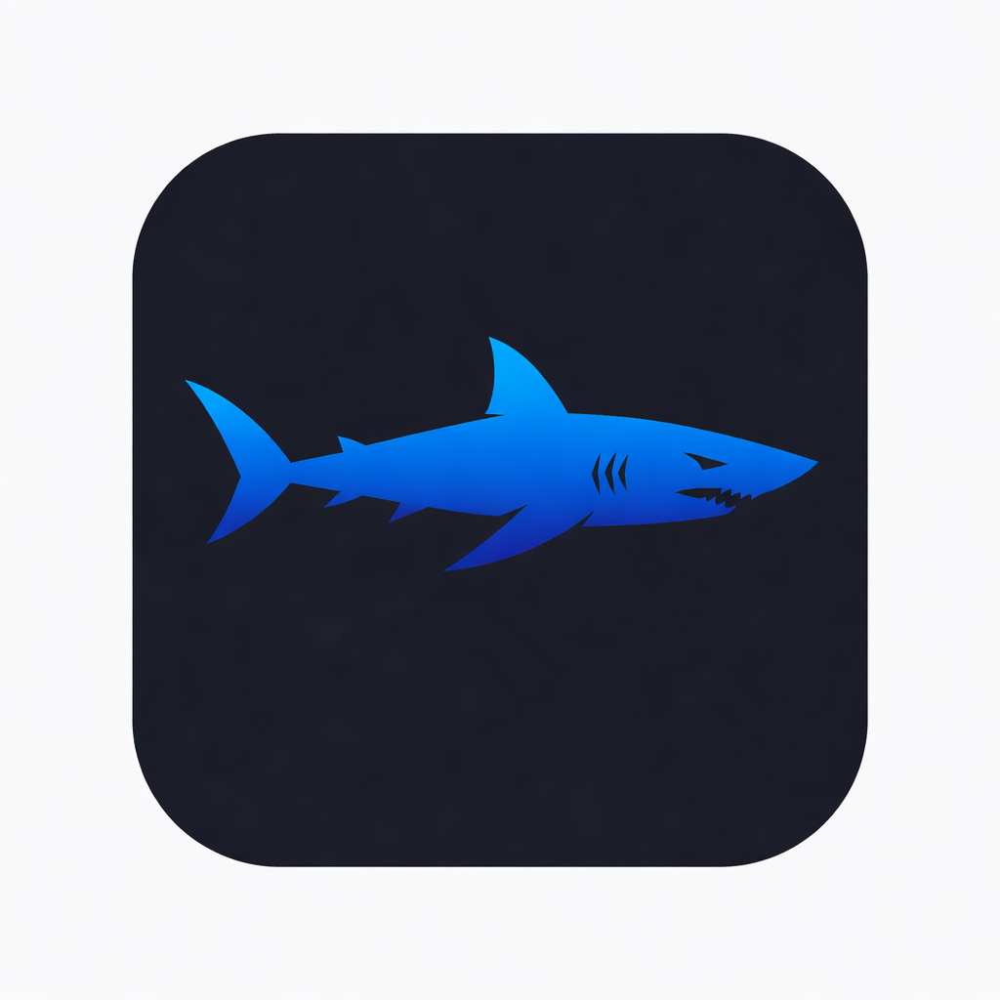
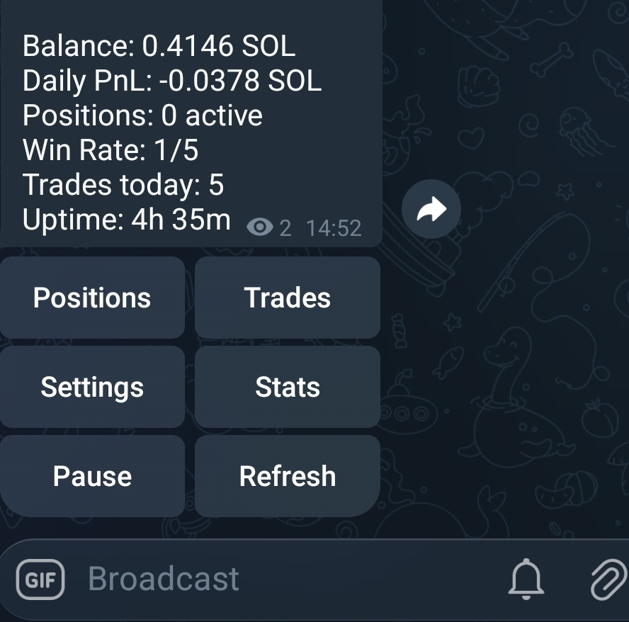
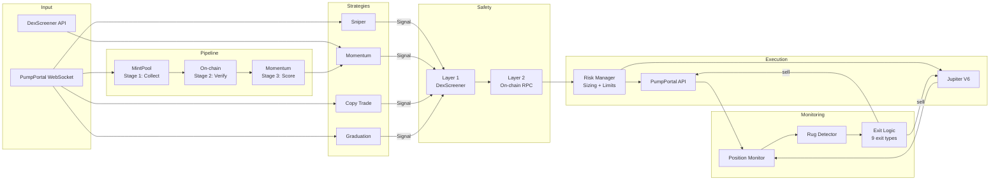

<p align="center">
  
</p>

<h1 align="center">Mako v3.0 — Solana Trading Engine</h1>

<p align="center">
  <a href="https://www.python.org/downloads/"></a>
  <a href="LICENSE"></a>
  <a href="https://solana.com"></a>
  <a href="https://pump.fun"></a>
</p>

<p align="center">
  Multi-strategy Solana trading engine with 3-stage discovery pipeline, real-time rug detection, copy-sell mirroring, and Telegram GUI. Not just a sniper.
</p>

<p align="center">
  
</p>

---

## Table of Contents

1. [Overview](#1-overview)
2. [Prerequisites](#2-prerequisites)
3. [Installation](#3-installation)
4. [Configuration](#4-configuration)
5. [Running the Bot](#5-running-the-bot)
6. [Architecture](#6-architecture)
7. [Strategies](#7-strategies)
8. [3-Stage Discovery Pipeline](#8-3-stage-discovery-pipeline)
9. [Safety System](#9-safety-system)
10. [Rug Detection](#10-rug-detection)
11. [Risk Management](#11-risk-management)
12. [Copy Trading](#12-copy-trading)
13. [Wallet Discovery](#13-wallet-discovery)
14. [Telegram Interface](#14-telegram-interface)
15. [Monitoring and Diagnostics](#15-monitoring-and-diagnostics)
16. [Execution Layer](#16-execution-layer)
17. [Database Schema](#17-database-schema)
18. [Operational Guide](#18-operational-guide)
19. [Troubleshooting](#19-troubleshooting)
20. [Upgrading from v2](#20-upgrading-from-v2)
21. [How Mako Compares](#21-how-mako-compares)

---

## 1. Overview

Mako continuously monitors pump.fun via WebSocket, evaluates tokens through a multi-stage pipeline, executes trades through PumpPortal or Jupiter, and manages positions with automated exit logic. All state is persisted to SQLite for crash recovery.

**Key capabilities:**
- 4 independent strategies (Sniper, Momentum, Copy Trade, Graduation)
- Dual-layer safety checks (DexScreener + on-chain RPC)
- Real-time rug detection (creator sells, curve drops, whale dumps)
- Post-graduation entry via Jupiter V6 swap routing
- Buyer uniqueness / Sybil detection
- Dynamic position sizing based on confidence, performance, and loss streaks
- Copy-sell mirroring (exit when smart money exits)
- Auto wallet discovery and scoring
- Telegram GUI with button-driven navigation
- Crash recovery via SQLite persistence
- Jito MEV bundle support

**Source:** ~8,200 LOC across 18 Python modules in `src/`.

---

## 2. Prerequisites

**System requirements:**
- Python 3.10 or higher
- 512 MB RAM minimum
- Linux / macOS / Windows (WSL recommended)
- Stable internet connection

**Paper trading:**
- A Solana RPC endpoint (public default works)

**Live trading:**
- A dedicated Solana wallet funded with SOL (never use your main wallet)
- A fast RPC endpoint (Helius, QuickNode, or Chainstack recommended)
- A PumpPortal account at https://pumpportal.fun (free)

---

## 3. Installation

```bash
# Clone or extract the project
cd solana-meme-bot

# Create virtual environment (recommended)
python3 -m venv venv
source venv/bin/activate

# Install dependencies
pip install -r requirements.txt

# Create configuration
cp .env.example .env
# Edit .env with your settings

# Verify installation
cd src
python main.py --help
```

---

## 4. Configuration

All settings are loaded from `.env`. The full list is documented below, grouped by function.

### 4.1 -- RPC Connection

```env
SOLANA_RPC_URL=https://api.mainnet-beta.solana.com
SOLANA_WSS_URL=wss://api.mainnet-beta.solana.com
FALLBACK_RPC_URL=
```

The public RPC works for paper trading. For live trading, a paid RPC is strongly recommended.

| Provider | Free Tier | Speed |
|----------|-----------|-------|
| Public Solana | Yes | 100-500ms |
| Helius | 100k req/day | 10-50ms |
| QuickNode | 50 req/sec | Fast |
| Chainstack | Paid only | Fast + gRPC |

### 4.2 -- Wallet

```env
WALLET_PRIVATE_KEY=
```

Leave empty for paper trading. For live trading, set to your wallet's base58-encoded private key.

### 4.3 -- PumpPortal

```env
PUMPPORTAL_API_KEY=
PUMPPORTAL_TRADE_FEED=false
```

| Mode | API Key | Description |
|------|---------|-------------|
| Local (free) | Empty | Bot builds and signs transactions, sends via your RPC |
| Lightning | Set key | PumpPortal signs and sends for you (faster) |

**The trade feed is opt-in and billed.** PumpPortal only serves per-token and per-wallet trade events (`subscribeTokenTrade`, `subscribeAccountTrade`) to WebSocket connections made with an API key whose linked wallet holds at least 0.02 SOL, and it charges that wallet 0.01 SOL per 10,000 trade events (per PumpPortal's data API page; check the current terms). New-token events are free and need no key.

Because the charge is real SOL even in paper mode, the bot connects with the key only when `PUMPPORTAL_TRADE_FEED=true`. If the keyed connection is refused outright, it falls back to the free feed. With the feed off, or with an unfunded key:

| Feature | Effect |
|---------|--------|
| Copy trade | No WebSocket events; relies on RPC polling only (up to ~30s late) |
| Rug detection | Creator-sell triggers never fire; only the 15-second on-chain curve check remains |
| Momentum | Buyer-uniqueness (Sybil) check and live-activity ranking have no data |
| Wallet discovery | No candidates are ever observed |
| WebSocket price exits | None; exits rely on polled prices |

The bot logs `PumpPortal refused the trade subscriptions` at startup when this happens, and the status report shows `Trade feed: REFUSED`. With the feed on, the status report shows the number of trade events received, which is what you are billed for.

### 4.4 -- Trading Mode

```env
TRADING_MODE=paper
NOTIFY_ONLY=false
```

| Setting | Behavior |
|---------|----------|
| `paper` | Simulates trades with a virtual SOL balance, charging the fees and slippage a live trade would pay (see below) |
| `live` | Executes real trades on Solana mainnet |
| `NOTIFY_ONLY=true` | Runs full pipeline but only sends alerts, does not execute |

**Paper-mode cost model**

```env
PAPER_SLIPPAGE_PCT=3.0
PAPER_FEE_PCT=1.5
PAPER_JUPITER_FEE_SOL=0.0005
```

Paper trades are charged on both the buy and the sell:

| Cost | pump.fun trades | Jupiter trades (graduated) |
|------|-----------------|----------------------------|
| Fixed | `PRIORITY_FEE_SOL` (after the `MAX_FEE_PCT_OF_TRADE` cap) plus `JITO_TIP_SOL` when `USE_JITO=true` | `PAPER_JUPITER_FEE_SOL` plus the Jito tip |
| Percentage | `PAPER_FEE_PCT` | `PAPER_FEE_PCT` |
| Slippage | `PAPER_SLIPPAGE_PCT` (doubled on stop-loss and rug exits) | same |

`PAPER_FEE_PCT` and `PAPER_JUPITER_FEE_SOL` are assumptions, not measured values. Adjust them to what you observe on real transactions. Paper mode still cannot model failed transactions or being outrun by faster bots, so treat its results as an upper bound.

Paper and live runs must use separate database files (`--db`). The bot refuses to start on a database that holds open positions from the other mode.

### 4.5 -- Strategy Selection

```env
STRATEGY=multi
```

| Value | Description |
|-------|-------------|
| `sniper` | Buy new tokens within seconds of creation |
| `momentum` | Buy new pump.fun tokens whose bonding curve is growing (on-chain pipeline, Section 8) |
| `copy_trade` | Mirror trades from smart money wallets |
| `graduation` | Buy tokens after they graduate from pump.fun |
| `multi` | Run all four strategies simultaneously |
| `copy_trade,graduation` | Comma-separated combination |

### 4.6 -- Position Sizing

```env
MAX_BUY_SOL=0.05
MOMENTUM_MAX_BUY_SOL=0.03
GRADUATION_MAX_BUY_SOL=0.04
COPY_MAX_BUY_SOL=0.02
MAX_PORTFOLIO_SOL=1.0
MAX_CONCURRENT_POSITIONS=10
DAILY_LOSS_LIMIT_SOL=0.3
MAX_DAILY_TRADES=30
```

Each strategy has its own cap, and the cap is a ceiling: confidence and recent performance can only reduce a position below it (see Section 11).

### 4.7 -- Exit Strategy

```env
STOP_LOSS_PCT=10
MOMENTUM_STOP_LOSS_PCT=12
TAKE_PROFIT_PCT=100
TAKE_PROFIT_2_PCT=300
TRAILING_STOP_PCT=25
PARTIAL_TAKE_PCT=50
MAX_HOLD_MINUTES=30
STALE_EXIT_MINUTES=10
STALE_EXIT_PCT=7
GRADUATED_TRAILING_2_PCT=35
FAST_STOP_GRACE_SEC=180
NOSTOP_WINDOW_SEC=180
NOSTOP_MULTIPLIER=4
NOSTOP_MAX_STOP_PCT=40
PROTECTED_STOP_PCT=50
WS_STOP_LOSS_ENABLED=false
```

**Exit timing parameters:**

| Parameter | Default | Description |
|-----------|---------|-------------|
| `FAST_STOP_GRACE_SEC` | 180 | Seconds after buy before the fast stop-loss checker can trigger. Prevents exits on entry slippage. |
| `NOSTOP_WINDOW_SEC` | 180 | Seconds after buy during which the stop-loss threshold is widened (multiplied by `NOSTOP_MULTIPLIER`). |
| `NOSTOP_MULTIPLIER` | 4 | Stop-loss multiplier during the no-stop window. |
| `NOSTOP_MAX_STOP_PCT` | 40 | Upper limit for the widened stop. A 12% stop x 4 = 48% is held at 40%; a 20% stop x 4 = 80% is held at 40%. Never tighter than the normal stop. |
| `PROTECTED_STOP_PCT` | 50 | Loss at which a position exits even while its stop is suppressed (curve-protected mode or graduation grace). |
| `WS_STOP_LOSS_ENABLED` | false | Whether WebSocket-derived prices can trigger stop-losses. Disabled by default because single-trade implied prices are noisy. WS take-profits still fire. |

The exit cascade:

```
Buy -> price drops past stop loss -> STOP LOSS (sell 100%)
Buy -> price rises to TP1 -> TAKE PROFIT PARTIAL (sell 50%)
     -> price rises to TP2 -> TAKE PROFIT FULL (sell remaining)
     -> OR price drops from peak -> TRAILING STOP (sell remaining)
     -> OR position goes flat for 10+ min -> STALE EXIT (sell 100%)
     -> OR max hold time reached -> TIME EXIT (sell 100%)
```

### 4.8 -- Momentum Filters

```env
MIN_MOMENTUM_CONFIDENCE=0.65
MIN_MOMENTUM_SOL_IN_CURVE=15.0
MIN_MOMENTUM_TXNS=30
MIN_MOMENTUM_CURVE_GROWTH=15
MIN_MOMENTUM_GROWTH_RATE=3
MAX_CREATOR_TX_COUNT=80
MIN_HOLDER_COUNT=5
```

These control the 3-stage discovery pipeline threshold for the momentum strategy.

### 4.9 -- Loss Cooldowns

```env
COOLDOWN_TRIGGER_LOSSES=5
COOLDOWN_DURATION_SEC=120
COOLDOWN_EXEMPT_CONFIDENCE=0.85
```

After N consecutive losses, the strategy pauses for the configured duration. Signals above the exempt confidence threshold bypass cooldown.

### 4.10 -- Token Filters

```env
MIN_LIQUIDITY_USD=5000
MIN_TOKEN_AGE_SEC=5
MAX_TOP_HOLDER_PCT=30
REQUIRE_SOCIAL=false
```

### 4.11 -- Copy Trading

```env
COPY_WALLETS=wallet1,wallet2,wallet3
COPY_DELAY_SEC=2
```

Comma-separated list of wallet addresses. See Section 12 for details.

### 4.12 -- Graduation

```env
GRAD_MIN_CURVE_PCT=75
GRAD_BUY_AT_PCT=88
GRAD_MAX_POOL_AGE_MIN=30
GRAD_MIN_TXNS_5M=5
USE_JUPITER=true
JUPITER_SLIPPAGE_BPS=1500
```

The bot tracks tokens approaching graduation, detects the event, waits 60-300s for the pool to establish, then buys via Jupiter.

| Parameter | Default | Description |
|-----------|---------|-------------|
| `GRAD_MIN_CURVE_PCT` | 75 | Start tracking a token at this curve fill %. |
| `GRAD_BUY_AT_PCT` | 95 | Not used. It dates from when the bot bought before graduation; buys now happen only after it. |
| `GRAD_MAX_POOL_AGE_MIN` | 30 | A post-graduation buy needs a DEX pool no older than this. An older pool means the token graduated long ago. |
| `GRAD_MIN_TXNS_5M` | 5 | Minimum trades in the last 5 minutes on DexScreener. Below this the bot waits, because a 0% price change with no trades is missing data, not a calm market. |

### 4.13 -- Rug Detection

```env
RUG_DETECTION=true
RUG_CREATOR_SELL_EXIT=true
RUG_CURVE_DROP_PCT=40
```

### 4.14 -- Wallet Discovery

```env
AUTO_DISCOVER_WALLETS=true
MAX_AUTO_WALLETS=10
MIN_WALLET_SCORE_TO_WATCH=50.0
WALLET_DISCOVERY_MIN_BUYS=2
WALLET_DISCOVERY_MIN_SELLS=1
WALLET_DISCOVERY_MIN_RATIO=1.15
WALLET_DISCOVERY_MIN_TOKENS=3
```

See Section 13 for how these are applied.

### 4.15 -- Execution

```env
SLIPPAGE_PCT=15
MOMENTUM_SLIPPAGE_PCT=12
PRIORITY_FEE_SOL=0.005
MAX_FEE_PCT_OF_TRADE=5
JITO_TIP_SOL=0.001
USE_JITO=true
POLL_INTERVAL_SEC=3
```

**Fees against position size.** `PRIORITY_FEE_SOL` is a fixed amount per transaction, so on a small position it is a large share of the trade: 0.005 SOL on each side of a 0.03 SOL position is a third of the stake before any price move. `MAX_FEE_PCT_OF_TRADE` caps the priority fee at a percentage of the trade's SOL size (5% of 0.03 SOL = 0.0015 SOL). Emergency sells (stop-loss, rug) pay double. Set it to `0` to always send `PRIORITY_FEE_SOL` unchanged. A lower fee can make transactions land more slowly in congested periods.

At startup the bot logs the fixed fees per round trip as a share of each enabled strategy's position size, and warns when it is 15% or more.

This cap applies to pump.fun trades through PumpPortal. Jupiter trades use Jupiter's automatic priority fee.

### 4.16 -- Telegram

```env
TELEGRAM_BOT_TOKEN=
TELEGRAM_CHAT_ID=
```

See Section 14 for the Telegram GUI interface.

### 4.17 -- Sniper

```env
SNIPER_BUY_DELAY_SEC=2
SNIPER_AUTO_SELL_SEC=30
SNIPER_MIN_SOL_LIQUIDITY=5
SNIPER_MIN_DEV_BUY_SOL=0.5
SNIPER_MAX_TOP_HOLDER_PCT=70
PIPELINE_MAX_TOP_HOLDER_PCT=50
```

---

## 5. Running the Bot

### Paper Trading

```bash
cd src
python main.py                              # mode from TRADING_MODE in .env (default paper)
python main.py --paper                      # force paper mode, whatever .env says
python main.py --strategy copy_trade,graduation
python main.py --debug                      # verbose logging
python main.py --max-sol 0.05
```

### Live Trading

```bash
python main.py --live
python main.py --live --strategy copy_trade,graduation --max-sol 0.1
```

A 5-second safety countdown runs before live trading starts.

### CLI Flags

| Flag | Description | Default |
|------|-------------|---------|
| `--paper` | Force paper trading, overriding `TRADING_MODE` | From `.env` |
| `--live` | Live trading mode | Off |
| `--strategy STR` | Strategy override | From `.env` |
| `--max-sol FLOAT` | Max SOL per trade | From `.env` |
| `--interval INT` | Poll interval (seconds) | From `.env` |
| `--debug` | Debug logging | Off |
| `--db PATH` | Database file path. Use a separate file for paper and live runs | `bot_state.db` |

### Background Execution

```bash
# Using screen
screen -S mako
cd src && python main.py --live
# Detach: Ctrl+A then D
# Reattach: screen -r mako

# Using systemd
sudo cp memebot.service /etc/systemd/system/
sudo systemctl enable memebot
sudo systemctl start memebot
```

---

## 6. Architecture

### Core Flow



```
main.py (CLI + config)
  -> MemeBot in bot.py (orchestrator)
    -> Strategies emit Signal objects
    -> Safety check (dual-layer)
    -> Risk check (sizing, cooldowns, limits)
    -> Execute via PumpPortal or Jupiter
    -> Monitor positions -> exit on triggers
```

### Concurrent Loops

The bot runs three long-lived tasks, plus short background tasks for each trade and for the copy-wallet RPC poll:

1. **WebSocket loop** (`_main_loop`): Event-driven, processes PumpPortal events in real-time (new tokens, wallet trades, token trades).

2. **Poll loop** (`_poll_loop`): Periodic tasks every 3 seconds -- position monitoring, momentum scanning, graduation polling, rug checks, Telegram event handling.

3. **Fast stop-loss loop** (`_fast_position_check`): Checks open positions every 500ms.

Buys and sells run as background tasks so a slow confirmation never blocks these loops.

### Module Map

| Module | LOC | Role |
|--------|-----|------|
| `main.py` | 109 | CLI entry point, argument parsing, logging setup |
| `bot.py` | 2,311 | Main orchestrator: event loop, 3-stage pipeline, trade execution, crash recovery |
| `strategies.py` | 440 | Sniper, CopyTrade and Graduation classes, emitting `Signal` or `SellSignal` objects. Momentum is the pipeline in `bot.py` |
| `txutil.py` | 237 | Shared transaction helpers: trade outcome (confirmed / failed / unknown), confirmation, transaction parsing |
| `pumpportal.py` | 486 | PumpPortal REST API + WebSocket client, Jito bundle support |
| `onchain.py` | 626 | On-chain analysis via Solana RPC: mint/freeze authority, holders, bonding curve |
| `safety.py` | 120 | Dual-layer safety checks wrapping DexScreener and on-chain data |
| `risk_manager.py` | 466 | Position tracking, exit logic (9 exit types), dynamic sizing, loss cooldowns |
| `rug_detector.py` | 238 | Real-time rug detection: creator sells, curve drops, whale dumps |
| `jupiter.py` | 229 | Jupiter V6 swap routing for graduated tokens |
| `wallet_discovery.py` | 250 | Auto-discover wallets worth copying from observed round trips |
| `market_data.py` | 223 | DexScreener + Jupiter Price API wrappers with caching |
| `db.py` | 397 | SQLite persistence: positions, trades, wallet scores, blacklists, loss streaks |
| `config.py` | 267 | Environment variable loading, validation, Solana program constants |
| `wallet.py` | 145 | Real Solana wallet (`Wallet`) and paper wallet (`PaperWallet`) |
| `notifications.py` | 220 | Telegram API client: messages, inline keyboards, callback queries |
| `telegram_ui.py` | 707 | Telegram GUI: button-driven dashboard, settings, positions, trade controls |
| `status.py` | 563 | CLI query tool for positions, trades, P&L, wallet scores |
| `monitor.py` | 445 | Live terminal dashboard (auto-refresh, read-only DB) |

### Data Sources

| Source | Protocol | Used By |
|--------|----------|---------|
| PumpPortal | WebSocket (`wss://pumpportal.fun/api/data`) | Sniper, CopyTrade, Graduation, MintPool, Rug Detector. Trade events need a funded API key (Section 4.3) |
| DexScreener | REST API | Momentum, Safety Layer 1, Post-graduation verification |
| Jupiter | REST API (`lite-api.jup.ag`) | Post-graduation swaps, SOL price |
| Solana RPC | JSON-RPC | Safety Layer 2, bonding curve reads, balance queries |
| Jito | REST API | MEV bundle submission |

### Key Data Types

```python
@dataclass
class Signal:
    mint: str
    symbol: str
    strategy: str
    confidence: float       # 0.0 to 1.0
    reason: str
    suggested_sol: float
    token_data: TokenData
    raw_event: dict
    creator: str

@dataclass
class SellSignal:
    mint: str
    symbol: str
    reason: str
    sell_pct: int           # 100 = full exit
    source_wallet: str

@dataclass
class Position:
    mint: str
    symbol: str
    entry_price: float
    sol_invested: float
    entry_time: float
    strategy: str
    peak_price: float
    partial_taken: bool
    graduated: bool
    curve_pct: float
    # ... additional fields
```

---

## 7. Strategies

### 7.1 -- Sniper

Listens to PumpPortal WebSocket for new token creation events. Evaluates tokens based on creator behavior, initial liquidity, metadata, and market cap. Buys within seconds of creation.

**Scoring factors:**
- Developer bought tokens at launch (+0.2)
- Token has name and metadata (+0.1 to +0.2)
- Market cap between 5-100 SOL (+0.2)
- Liquidity above minimum (+0.15)
- Minimum confidence: 0.45

**Auto-sell:** After `SNIPER_AUTO_SELL_SEC` seconds, the position is closed regardless of price.

**Note:** Simulation data shows sniper is net-negative due to the ~98% rug rate on pump.fun. Recommended only as part of a multi-strategy setup.

### 7.2 -- Momentum

Evaluates tokens through the 3-stage discovery pipeline (see Section 8). Scores tokens by bonding curve growth rate, transaction velocity, buyer uniqueness, and holder distribution.

**Pipeline requirements:**
- Curve growth above `MIN_MOMENTUM_CURVE_GROWTH` percent
- Growth rate above `MIN_MOMENTUM_GROWTH_RATE` percent per minute
- Minimum transaction count and SOL in curve
- Buyer uniqueness above 30% (Sybil detection)
- Curve higher than at an earlier pipeline cycle (sustained growth)
- On-chain safety pass (mint/freeze authority, holder concentration)

**Confidence:** 0.65 to 1.0 based on growth rate, transaction velocity, uniqueness, and age.

### 7.3 -- Copy Trade

Subscribes to PumpPortal WebSocket for trade events from configured smart money wallets, and polls the same wallets over RPC to catch trades on other DEXes. Mirrors buys and exits.

**Buy signals:**
- Baseline confidence: 0.3 to 0.9 (based on wallet score)
- Large buy (1+ SOL): +0.2
- Early market cap (< 200 SOL): +0.1
- Wallets with 5+ consecutive losses are suspended for 1 hour

**Sell mirroring:**
- Watched wallet sells ALL tokens -> bot sells 100%
- Watched wallet partially sells -> bot sells 50%

**Wallet scoring:** Tracks win rate, profitability, and streaks per wallet. Scores persist in the database. Wallets scoring below 30 after 10+ trades are auto-skipped.

### 7.4 -- Graduation

Monitors tokens approaching bonding curve graduation (100% = ~85 SOL). Detects the graduation event, waits for the PumpSwap/Raydium pool to establish, then buys via Jupiter.

**Flow:**
1. Track tokens at `GRAD_MIN_CURVE_PCT`+ curve fill (on-chain RPC polling)
2. Detect graduation: the curve reads 100% on-chain **and** the bot read the same token below 100% earlier
3. Wait 60-300 seconds for pool liquidity
4. Verify via DexScreener: liquidity of $5,000+, pool no older than `GRAD_MAX_POOL_AGE_MIN`, at least `GRAD_MIN_TXNS_5M` trades in 5 minutes, 5-minute change between -30% and +150%
5. Execute buy via Jupiter swap

**Detection guards.** A token that had already graduated before the bot first saw it is ignored, so an event for an old token is never treated as a fresh graduation. The curve percentage estimated from WebSocket event data is used only to skip RPC calls for tokens far from graduation; it never declares a graduation.

**Entry sizing.** Confidence is highest for a 5-minute change of -15% to -5%, then for a flat price, and lowest when chasing a rise. These buckets are a heuristic with no recorded trade data behind them.

**Post-graduation positions** receive wider trailing parameters: 35% trailing stop, TP2 sells only 50% (holds remainder for continued upside). Their stop-loss is armed from entry; the 5-minute graduation grace applies only to positions that were held through the migration.

---

## 8. 3-Stage Discovery Pipeline

The momentum strategy uses a 3-stage pipeline to filter tokens from WebSocket events to trade execution.

### Stage 1 -- MintPool (WebSocket ingestion)

All new token creation events are collected into a scored candidate pool. Each candidate is scored by:

- **Age:** for momentum, tokens up to 6 minutes old score highest and the score falls off to nothing past 10 minutes, matching the Stage 3 scorer. The graduation poll ranks the same pool with a 5-12 minute sweet spot instead.
- **Live activity (momentum only):** trades seen on the WebSocket since creation (10+ and 30+ add to the score)
- **Initial buy amount:** Creator's initial buy (log-scaled, proof of commitment)
- **Market cap at creation:** Higher initial interest scores better

The pool holds up to 600 candidates, pruning the oldest when full. The top 20 candidates by score are passed to Stage 2.

### Stage 2 -- On-Chain Activity Check

Ten candidates per cycle are checked for recent activity: the six best-ranked, plus four that rotate through the rest of the top 20 so lower-ranked tokens are still looked at. A candidate needs at least 5 transactions on its bonding curve in the last 5 minutes (falling back to the WebSocket trade count when the RPC returns nothing). The count reads up to 300 signatures.

Active candidates advance to Stage 3. The on-chain safety checks (freeze authority, holder concentration, creator history) run later, on any signal that Stage 3 emits, before the buy.

### Stage 3 -- Momentum Evaluation

Surviving candidates are evaluated for trading momentum:

- **Curve growth:** Percent increase in bonding curve SOL since creation
- **Growth rate:** Curve growth per minute (filters whale-only pumps)
- **Transaction rate:** Transactions per minute over the last 5 minutes (or the token's age, if younger)
- **Sustained growth:** The curve must be higher than at a pipeline cycle 4-90 seconds earlier. A token seen for the first time waits one cycle (`2PT-WAIT` in the log); one that has not grown is skipped (`2PT-FAIL`). A 2-second recheck then confirms the curve is not falling.
- **Buyer uniqueness:** Unique wallets / total buys (Sybil detection)
  - Below 30%: hard block (likely wash trading)
  - Above 80%: confidence boost

Tokens that pass all three stages emit a `Signal` for execution.

---

## 9. Safety System

Every trade passes through a dual-layer safety check before execution.

### Layer 1 -- DexScreener Data

| Check | Measurement | Scoring |
|-------|-------------|---------|
| Liquidity | USD liquidity depth | 100 if >= $100k, down to 10 if < $5k |
| Age | Time since creation | 100 if >= 1 day, 15 if < 1 min |
| Honeypot | Sell ratio (sells / total) | 100 if >= 30%, 5 if < 3% |
| Volume | Volume/liquidity ratio | 100 if 0.5-15x, lower otherwise |
| MCap Ratio | Market cap / liquidity | 100 if < 30x, 10 if > 200x |

### Layer 2 -- On-Chain Verification

| Check | What It Reads | Threshold |
|-------|---------------|-----------|
| Mint Authority | Can creator mint more tokens | Hard block if not revoked |
| Freeze Authority | Can creator freeze wallets | Hard block if active |
| Top Holder | Largest wallet concentration | Hard block if > 60% |
| Top 5 Holders | Whale concentration | Warning if > 80% |
| Creator History | Recent transaction count | Warning if 50+ (serial deployer) |
| Bonding Curve | Graduation progress | Used by graduation strategy |

### Weighted Scoring

When on-chain data is available:
```
Final = liquidity(20%) + age(8%) + honeypot(22%) + volume(10%) + mcap(10%) + onchain(30%)
```

Pass thresholds:
- Regular: final >= 40, liquidity >= 30, honeypot >= 20, freeze revoked
- Snipe: final >= 25, honeypot >= 15, freeze revoked, top holder within limit

**Unreadable data.** With `SAFETY_FAIL_CLOSED=true` (default), a buy is skipped when the on-chain data could not be read (RPC error). The log shows `Safety SKIP` and the token is not blacklisted. Set it to `false` to proceed without the on-chain layer.

---

## 10. Rug Detection

The rug detector monitors all held positions in real-time through two channels.

### Event-Driven Detection (WebSocket)

Processes every trade event on tokens the bot holds:

| Signal | Condition | Severity | Action |
|--------|-----------|----------|--------|
| Creator sells all | Token balance drops to 0 | Critical | Sell 100% |
| Creator large sell | Single sell >= 5 SOL (10 SOL near graduation) | Critical | Sell 100% |
| Creator cumulative sell | Total sells >= 8 SOL (12 SOL near graduation) | Critical | Sell 100% |
| Creator multiple sells | 3+ separate sell transactions | Critical | Sell 100% |
| Whale dump | Non-creator sell >= 10 SOL | Warning | Log only |

### Polling-Based Detection (RPC)

Checks on-chain state every 15 seconds per token:

| Signal | Condition | Severity | Action |
|--------|-----------|----------|--------|
| Curve drop | Bonding curve SOL drops >= 40% | Critical | Sell 100% |
| Curve minor drop | Bonding curve drops >= 20% | Warning | Log only |

**Graduated exception:** Tokens that have graduated are expected to have 0 SOL in their bonding curve. The rug detector skips curve checks for graduated tokens.

**Near-graduation exception:** Tokens above 90% curve fill have higher thresholds for creator sell detection (10 SOL single, 12 SOL cumulative) since creator sells near graduation are less indicative of a rug.

---

## 11. Risk Management

### Dynamic Position Sizing

```
Final Size = min(Base Size x Confidence x Strategy x Wallet multipliers, Base Size)
```

**Base size:** Minimum of the strategy's cap, 15% of balance, or remaining portfolio capacity.

The base size is the ceiling. The multipliers below can only reduce a position; a multiplier above 1 just offsets another one below 1.

**Confidence multiplier (0.5x to 1.5x):**
- Signal confidence 0.25 -> 0.75x
- Signal confidence 0.50 -> 1.0x
- Signal confidence 0.90 -> 1.4x

**Strategy multiplier (0.4x to 1.3x):**
- Win rate > 60% in last 24h -> 1.3x
- Win rate < 35% -> 0.6x
- 5+ loss streak -> 0.4x

**Wallet multiplier (copy trades only):**
- Based on wallet score / 50 (range 0.25x to 1.5x)
- Further reduced after 3+ consecutive losses from that wallet

### Exit Logic

The risk manager evaluates 9 exit conditions on every position check (every 3 seconds):

1. **Auto-sell timer** (sniper only) -- sells at configured time
2. **Stop-loss** -- base threshold with confirmation timer (8 seconds), curve-protection mode, and graduation grace period
3. **Take-profit partial (TP1)** -- sells `PARTIAL_TAKE_PCT` at first target
4. **Take-profit full (TP2)** -- sells remaining at second target (50% for graduated tokens)
5. **Trailing stop (graduated post-TP2)** -- 35% drop from peak after TP2
6. **Trailing stop (tight, after TP1)** -- 12% drop from peak after partial take
7. **Trailing stop (general)** -- 25% drop from peak when PnL > 20%
8. **Stale exit** -- flat position (within +/- 7%) for 10+ minutes
9. **Time exit** -- exceeds max hold duration

**Fast stop-loss grace:** The fast stop-loss checker (500ms polling) does not fire until `FAST_STOP_GRACE_SEC` (default 180s) after entry. This prevents exits from entry slippage and normal early volatility.

**No-stop window:** For `NOSTOP_WINDOW_SEC` (default 180s) after entry, the stop-loss threshold is multiplied by `NOSTOP_MULTIPLIER` (default 4x) but never above `NOSTOP_MAX_STOP_PCT` (default 40%). This applies in both the fast checker and the main poll loop.

**Stop-loss confirmation:** Price must stay below the stop threshold for 8 seconds to trigger, filtering out momentary volatility spikes. Catastrophic dumps (multiplier x threshold) trigger immediate exit.

**WebSocket stop-losses:** Disabled by default (`WS_STOP_LOSS_ENABLED=false`). Single-trade implied prices are noisy and trigger false stop-losses. WS take-profits and trailing stops still fire normally.

**Curve-protected mode:** When the bonding curve is above 60% and rising with fresh data (< 30s old), the stop-loss is suppressed to allow the token to reach graduation. Only a loss of `PROTECTED_STOP_PCT` (default 50%) or a 15%+ curve drop triggers exit.

**Graduation grace period:** For 5 minutes after a held position graduates, stop-loss is suppressed (down to `PROTECTED_STOP_PCT`) to survive the migration price dip. This applies only to positions the bot held on the bonding curve. A token bought after it graduated, or found already graduated, keeps its normal stop.

**Sell verification:** A live position is closed only when the sell transaction is confirmed or the wallet's token balance shows the tokens are gone. A sell that cannot be verified leaves the position open and is retried (every 30s, then every 5 minutes after 10 failures, with a Telegram alert). Positions are never written off while the tokens are still held.

### Loss Cooldowns

| Consecutive Losses | Cooldown Duration | Size Reduction |
|-------------------|-------------------|----------------|
| 5 | 120 seconds | 0.4x |
| 3 | Proportional | 0.6x |
| Global (multiple strategies) | 2x duration | Applied across all |

Signals with confidence above `COOLDOWN_EXEMPT_CONFIDENCE` (default 0.85) bypass cooldown.

### Circuit Breakers

- **Daily loss limit:** All trading stops when cumulative daily losses exceed `DAILY_LOSS_LIMIT_SOL`
- **Daily trade cap:** Maximum `MAX_DAILY_TRADES` per day
- **Concurrent position limit:** Maximum `MAX_CONCURRENT_POSITIONS` open at once
- **Portfolio limit:** Total invested SOL cannot exceed `MAX_PORTFOLIO_SOL`

---

## 12. Copy Trading

### Finding Smart Money Wallets

**GMGN.ai (recommended):**
1. Visit https://gmgn.ai, navigate to Smart Money / Top Traders
2. Filter: Solana, Last 7 days, Win Rate > 50%, PnL > 0
3. Look for consistent winners with 20+ trades and reasonable sizes (0.1-5 SOL)

**Birdeye / Solscan:**
- Browse token pages for top traders
- Track wallets that appear across multiple successful tokens

### Evaluating a Wallet

Before adding a wallet, verify:
- Win rate above 50% over multiple days
- 3-20 trades per day (too few = insufficient data, too many = possible wash trader)
- Not a bundler (does not create tokens and buy with other wallets)
- Trade size compatible with your bankroll

### Configuration

```env
COPY_WALLETS=7xKXtg2CW87d97TXJSDpbD5jBkheTqA83TZRuJosgAsU,4vMsoUT2BWatFweudnQM1xedRLfJgJ7hswhcpz4xgBTy
```

Copy wallets can also be added and removed live through the Telegram GUI (Settings -> Copy Wallets).

### Wallet Scoring

The bot tracks per-wallet performance:
- Score = WinRate x 0.6 + Profitability x 0.3 + Streak x 0.1
- Scores range 0-100, persist across restarts
- Wallets below score 30 after 10+ trades are auto-skipped
- Wallets with 5+ consecutive losses are suspended for 1 hour

Query scores:
```bash
sqlite3 bot_state.db "SELECT substr(wallet,1,12)||'...' as wallet, ROUND(score,1), total_trades, winning_trades, ROUND(total_pnl_sol,4) FROM wallet_scores ORDER BY score DESC;"
```

### Limitation

PumpPortal `subscribeAccountTrade` only covers pump.fun bonding curve trades. If watched wallets trade on Raydium or Jupiter (graduated tokens), those events will not be received over the WebSocket. The bot supplements this with RPC polling of wallet transactions:

- Runs about every 30 seconds in the background, so a copied trade can be up to ~30 seconds late.
- Polls up to 8 wallets: your `COPY_WALLETS` first, then auto-discovered ones.
- Reads the last 15 signatures per wallet and processes up to 8 new ones, oldest first. A wallet that trades more than that between polls has some trades missed, and the log says so.
- Ignores swaps into wrapped SOL, USDC and USDT.
- Failures are logged as warnings (`Wallet poll failed`), and the status report shows `Wallet RPC polls: N ok, M failed`, so a broken poller is distinguishable from idle wallets.

Scores are kept for copy wallets only. Token creators are never written to `wallet_scores`, and a losing copy trade does not blacklist the copied wallet as a creator.

---

## 13. Wallet Discovery

The bot can automatically discover and promote profitable wallets for copy trading.

### How It Works

1. **Observation:** Trade events from the WebSocket are recorded per wallet and per token. The bot only sees a token's trades while it is subscribed to that token, so a wallet whose first visible trade on a token is a sell bought before the bot was watching: that token is marked incomplete and never counts as a profit.

2. **Promotion from candidates:** A wallet is promoted when all of these hold:
   - at least `WALLET_DISCOVERY_MIN_BUYS` buys and `WALLET_DISCOVERY_MIN_SELLS` sells observed;
   - complete round trips (buy and sell both seen) on at least `WALLET_DISCOVERY_MIN_TOKENS` different tokens (default 3);
   - more than half of those tokens sold for more than they cost;
   - SOL sold is at least `WALLET_DISCOVERY_MIN_RATIO` times SOL bought across them;
   - the wallet has never been seen creating a token. A creator selling into its own buyers looks exactly like a profitable trader.

3. **Promotion from DB scores:** Wallets with score >= `MIN_WALLET_SCORE_TO_WATCH`, win rate >= 55%, and 5+ trades are promoted. Scores exist only for wallets the bot has copied, so this mainly keeps the list consistent across restarts. Anti-wash filters exclude wallets with suspiciously perfect win rates.

4. **Demotion:** Auto-discovered wallets with 10+ trades and score below 30 are removed.

### Configuration

```env
AUTO_DISCOVER_WALLETS=true
MAX_AUTO_WALLETS=10
MIN_WALLET_SCORE_TO_WATCH=50.0
WALLET_DISCOVERY_MIN_BUYS=2
WALLET_DISCOVERY_MIN_SELLS=1
WALLET_DISCOVERY_MIN_RATIO=1.15
WALLET_DISCOVERY_MIN_TOKENS=3
```

Manual wallets (from `COPY_WALLETS`) are never demoted.

---

## 14. Telegram Interface

The bot provides a button-driven Telegram GUI similar to Trojan or BonkBot. All navigation edits a single persistent message in-place, creating an app-like experience.

### Setup

1. Create a bot via @BotFather on Telegram
2. Get your chat ID via @userinfobot
3. Add to `.env`:
```env
TELEGRAM_BOT_TOKEN=123456789:ABCdefGHIjklMNOpqrsTUVwxyz
TELEGRAM_CHAT_ID=987654321
```

### Screens

**Home Dashboard** (`/start`)
- Wallet address, SOL balance, daily PnL
- Open positions count, win rate, trade count, uptime
- Navigation buttons: Positions, Trades, Settings, Stats, Pause/Resume

**Positions**
- List of all open positions with PnL percentage, held time, strategy
- Per-position sell buttons (50% or 100%)
- Sell All button (with confirmation)

**Trades**
- Recent closed trades with PnL, strategy, exit reason, time ago

**Stats**
- Today and weekly trade counts, PnL, win rates
- Breakdown by strategy

**Settings**
- Current values for all key parameters
- Tap any setting to see preset buttons or enter a custom value
- Configurable: Stop Loss, Take Profit, TP2, Trailing, Max Buy, Confidence, Growth, Growth Rate, Max Hold, Slippage, Fast Stop Grace, No-Stop Window, No-Stop Multiplier

**Strategies**
- Toggle individual strategies on/off without restart
- Shows which strategies are loaded and active

**Copy Wallets**
- View current copy trade wallets
- Add new wallets by pasting address (validates format)
- Remove wallets with a button tap
- Changes take effect immediately (WebSocket subscriptions update live)

**Pause / Resume**
- Pause: bot monitors but does not execute trades
- Resume: trading resumes immediately
- Both require confirmation

### Security

- All events are checked against `TELEGRAM_CHAT_ID`. Unknown chats are silently ignored.
- Setting changes are validated against min/max ranges.
- Destructive actions (Sell All, Pause) require two-step confirmation.
- Wallet private keys are never displayed.

---

## 15. Monitoring and Diagnostics

### Log File

The bot writes to both stdout and `bot.log` (10 MB rotating, 3 backups).

```bash
# Follow live logs
tail -f bot.log

# Search for trades
grep "NOTIFY-ONLY\|Would buy\|execute" bot.log

# Search for pipeline activity
grep "Pipeline Stage 3\|NEAR-MISS\|FILTERED" bot.log

# Search for rug signals
grep "Creator sold\|curve dropped\|PEAKED" bot.log
```

### CLI Tools

```bash
# On-demand status query
python status.py

# Live terminal dashboard (auto-refresh)
python monitor.py
```

### Database Queries

```bash
# Recent trades with PnL
sqlite3 bot_state.db "SELECT datetime(timestamp,'unixepoch','localtime'), symbol, strategy, ROUND(pnl_sol,4), reason FROM trades WHERE action='sell' ORDER BY timestamp DESC LIMIT 20;"

# Strategy performance
sqlite3 bot_state.db "SELECT strategy, COUNT(*), SUM(CASE WHEN pnl_sol>0 THEN 1 ELSE 0 END) as wins, ROUND(SUM(pnl_sol),4) FROM trades WHERE action='sell' GROUP BY strategy;"

# Open positions
sqlite3 bot_state.db "SELECT symbol, strategy, ROUND(sol_invested,4) FROM positions;"

# Blacklisted creators
sqlite3 bot_state.db "SELECT COUNT(*) FROM creator_blacklist;"
```

---

## 16. Execution Layer

### PumpPortal (Bonding Curve Tokens)

Used for buying and selling tokens still on the pump.fun bonding curve.

- **Lightning mode:** PumpPortal builds, signs and sends via their API. The API key's wallet must be the same wallet as `WALLET_PRIVATE_KEY`; if the first Lightning transaction shows a different wallet, Lightning is disabled and a critical alert is sent.
- **Local mode:** Bot builds transaction, signs with keypair, sends via RPC
- **Fallback chain:** Lightning → Jito bundle → primary RPC → fallback RPC
- **Confirmation:** Every signature, Lightning or local, is confirmed with `getSignatureStatuses` before a position is opened or closed

**Trade outcomes.** A trade is `confirmed`, `failed` or `unknown`. `unknown` means the bot cannot tell (RPC down, or a request timed out after being sent), and it is never treated as a failure or a success:

- A buy is re-sent only after a definite failure. After a timeout the same signature is watched until its blockhash expires (about 90 seconds), and the wallet balance decides.
- A Lightning request that timed out or returned no signature is not followed by a local buy, because the first one may still land.
- Partial sells are never re-sent on timeout (selling 50% twice sells 75%). Full sells may be re-sent.

### Jupiter (Graduated Tokens)

Used for buying and selling tokens that have graduated to PumpSwap or Raydium.

- Quote API for price discovery and route optimization
- Swap API for transaction generation
- Supports Jito bundle submission for MEV protection
- **RPC fallback:** Primary RPC → fallback RPC for both sends and confirmations
- Confirmation with exponential backoff (0.5s to 3s)

### RPC Fallback

All RPC-dependent operations (balance checks, trade sends, tx confirmations, tx lookups) try the primary RPC first and automatically fall back to `FALLBACK_RPC_URL` if it fails. The momentum pipeline also falls back to WebSocket trade counts when `getSignaturesForAddress` is unavailable on both RPCs.

### Jito MEV Bundles

When `USE_JITO=true`, the bot:
1. Builds a separate tip transaction to a Jito validator
2. Bundles the trade transaction with the tip
3. Submits to the Jito block engine
4. Falls back to direct RPC submission on failure

This provides faster transaction inclusion and front-running protection.

### Venue Selection

The bot automatically selects the execution venue:
- **Not graduated:** PumpPortal (Lightning → local RPC)
- **Graduated:** Jupiter (Jito → primary RPC → fallback RPC)

Graduation status is checked on-chain and cached per position.

---

## 17. Database Schema

SQLite database (`bot_state.db`) with the following tables:

### positions
Stores all open positions for crash recovery.
```
mint, symbol, entry_price, entry_sol_price, tokens, sol_invested,
entry_time, strategy, peak_price, partial_taken, auto_sell_at,
tx_signature, extra (JSON)
```

### trades
Complete trade history for analysis.
```
id, mint, symbol, strategy, action (buy/sell/partial_sell),
sol_amount, tokens, price_usd, pnl_sol, pnl_pct, reason,
tx_signature, timestamp
```

### wallet_scores
Per-wallet copy trading performance.
```
wallet, total_trades, winning_trades, total_pnl_sol,
last_trade_time, avg_hold_sec, tokens_traded (JSON), streak, score
```

### bot_state
Key-value store for persistent bot state.
```
key, value (JSON), updated_at
```

### token_blacklist / creator_blacklist
Blocked tokens and creators.
```
mint/creator, reason, added_at
```

### loss_streaks
Per-strategy consecutive loss tracking and cooldowns.
```
id, strategy, consecutive_losses, last_loss_time, cooldown_until
```

---

## 18. Operational Guide

### First Run Checklist

1. Set `TRADING_MODE=paper` in `.env`
2. Set `STRATEGY=copy_trade,graduation` (safest combination)
3. Add 2-3 verified smart money wallets to `COPY_WALLETS`
4. Run `python main.py --debug`
5. Watch logs for 30+ minutes
6. Verify safety blocks are firing ("Safety FAIL" messages expected)
7. Verify signals are being generated
8. Run in paper mode for 3-7 days
9. Review performance in database before going live

Paper results include modelled fees and slippage (Section 4.4) but not failed transactions or competition from faster bots, so expect live results to be worse.

### Going Live

1. Confirm paper trading results are acceptable
2. Fund a dedicated wallet with 1-2 SOL
3. Set conservative limits: `MAX_BUY_SOL=0.05`, `DAILY_LOSS_LIMIT_SOL=0.3`
4. Set `TRADING_MODE=live`
5. Use a new database file for live trading (`--db live.db`); the bot will not start on a database holding open paper positions
6. Check the startup log line `Fixed fees for <strategy>` and make sure fees are a small share of your position size
7. Run with `python main.py --live`
8. Monitor closely for the first few hours
9. Scale up gradually after demonstrating profitability

### Database Maintenance

The bot auto-cleans data older than 7 days.

```bash
# Backup
cp bot_state.db bot_state_backup.db

# Full reset
rm bot_state.db

# Clear trade history only
sqlite3 bot_state.db "DELETE FROM trades; DELETE FROM wallet_scores; DELETE FROM loss_streaks;"
```

---

## 19. Troubleshooting

### Bot Will Not Start

| Error | Resolution |
|-------|------------|
| `ModuleNotFoundError` | Run `pip install -r requirements.txt` |
| `SOLANA_RPC_URL required` | Create `.env` from `.env.example` |
| `WALLET_PRIVATE_KEY required` | Add private key or use `--paper` |
| `COPY_WALLETS required` | Add wallet addresses or change strategy |

### Bot Runs but No Trades

| Symptom | Cause | Resolution |
|---------|-------|------------|
| "Daily loss limit" | Circuit breaker triggered | Wait for next day or increase limit |
| "Max positions" | Position limit reached | Wait for exits or increase limit |
| "Loss cooldown" | Strategy paused after losses | Wait for cooldown (max 5 min) |
| "Safety FAIL" on all tokens | On-chain checks blocking | Expected -- most meme coins are unsafe |
| "Safety SKIP" on all tokens | RPC cannot serve the on-chain reads | Use a better RPC, or set `SAFETY_FAIL_CLOSED=false` to trade without them |
| "2PT-WAIT" then nothing | Token passed scoring once but did not keep growing | Expected -- the signal needs growth across two pipeline cycles |
| "POST-GRAD: ... not a fresh graduate" | DEX pool older than `GRAD_MAX_POOL_AGE_MIN` | Expected -- the token graduated long ago |
| "POST-GRAD: ... only N trades in 5m" | No real trade data yet on DexScreener | The bot waits up to 5 minutes after graduation |
| "Copy trade events received: 0" | Wallets idle, the RPC poll is failing, or the trade feed is refused | Check `Wallet RPC polls: N ok, M failed` and `Trade feed:` in the status report |
| "PumpPortal refused the trade subscriptions" | `PUMPPORTAL_TRADE_FEED` is off, no `PUMPPORTAL_API_KEY`, or its wallet holds under 0.02 SOL | Turn the feed on with a funded key (Section 4.3, billed per event), or accept the reduced feature set |
| "Startup refused" | Database holds positions from the other mode | Use a separate file with `--db` |
| No signals at all | Filters too strict or quiet market | Lower growth thresholds via Telegram Settings |
| `[NOTIFY-ONLY]` prefix | Bot is in notify-only mode | Set `NOTIFY_ONLY=false` or Resume via Telegram |
| All Stage 3 filtered `low_growth` | Growth/rate thresholds too high | Lower via Settings -> Growth and Rate |

### Transaction Failures

| Error | Resolution |
|-------|------------|
| Buy fails repeatedly | Increase `SLIPPAGE_PCT`, or raise `MAX_FEE_PCT_OF_TRADE` / `PRIORITY_FEE_SOL` |
| "Sell FAILED" / "UNSOLD" alert | Token may be a honeypot; the position stays open and is retried. Try selling manually on pump.fun |
| "Priority fee capped at ..." | Informational: `MAX_FEE_PCT_OF_TRADE` reduced the fee for a small trade |
| "Tx confirmation timeout" | RPC too slow; upgrade to Helius or QuickNode |
| "Balance error: SolanaRpcException" | RPC rate limited or down; bot uses cached balance as fallback |

### High Loss Rate

| Issue | Resolution |
|-------|------------|
| Sniper losing money | Disable sniper: use `copy_trade,graduation` |
| Copy trading losing | Check wallet scores; remove wallets below 30 |
| Creator rugs on every token | Increase `MAX_CREATOR_TX_COUNT` filter, reduce `MAX_TOP_HOLDER_PCT` |
| Fees eating profits | Check the `Fixed fees for <strategy>` line at startup. Lower `PRIORITY_FEE_SOL` or `MAX_FEE_PCT_OF_TRADE`, or raise the per-strategy position caps |

---

## 20. Upgrading from v2

1. Back up your `.env` file and `bot_state.db`
2. Extract v3 into a new directory
3. Copy your `.env` to the new directory
4. No configuration changes required -- v3 is backward compatible
5. The bot will create a new database on first run if needed

New features in v3 that activate automatically:

| Feature | Default |
|---------|---------|
| On-chain safety (Layer 2) | Enabled, uses existing RPC |
| Crash recovery | Enabled, persists to SQLite |
| Loss cooldowns | 120 seconds after 5 consecutive losses |
| Dynamic sizing | Adjusts within MAX_BUY_SOL limit |
| Copy-sell mirroring | Active when copy_trade strategy is enabled |
| Wallet scoring | Starts tracking from first trade |
| Rug detection | Enabled (creator sells, curve drops) |
| Post-graduation entry | Enabled for graduation strategy |
| Buyer uniqueness / Sybil detection | Enabled for momentum pipeline |
| Wallet discovery | Enabled, max 10 auto wallets |
| Telegram GUI | Available when bot token and chat ID are configured |

---

## 21. How Mako Compares

| Feature | Mako | Typical OSS Sniper Bot |
|---------|------|------------------------|
| Strategies | 4 (Sniper, Momentum, Copy Trade, Graduation) | 1 (sniper only) |
| Discovery pipeline | 3-stage (collect, verify, score) | None |
| Safety checks | Dual-layer (DexScreener + on-chain RPC) | Basic metadata or none |
| Rug detection | Real-time (creator sells, curve drops, whale dumps) | Basic mint/freeze check |
| Copy trading | Copy-buy + copy-sell mirroring | Copy-buy only |
| Wallet discovery | Auto-discover and score profitable wallets | Manual config |
| Post-graduation | Jupiter V6 swap after bonding curve completion | Not supported |
| Sybil detection | Buyer uniqueness tracking per token | Not supported |
| Telegram interface | Full GUI with inline keyboards and live config | Text commands or none |
| Position management | 9 exit types, trailing stops, partial takes | Fixed stop-loss at best |
| Crash recovery | SQLite persistence, auto-recovery on restart | State lost on crash |
| Position sizing | Dynamic (confidence, performance, loss streaks) | Fixed amount |

---

## Disclaimer

This software is provided for educational and experimental purposes only. Trading meme coins carries extreme risk. The vast majority of meme coins lose all value. Never trade with funds you cannot afford to lose entirely. Past performance and simulation results do not guarantee future outcomes. The authors accept no responsibility for financial losses incurred through the use of this software.
